<!-- head: 5f8c7ed40152ef4025413747526d533ee1079d16 -->
## Demo video

Recorded on the test stack from the e2e specs this PR changes: `e2e/teststack/brand-1.spec.ts`, `e2e/teststack/brand-2.spec.ts`, `e2e/teststack/brand-3.spec.ts`, `e2e/teststack/epic-359.spec.ts` (commit 5f8c7ed).

### ✅ TC-BRAND-1-06 Brands page has heading "Brands" and one card per brand in alphabetical order

[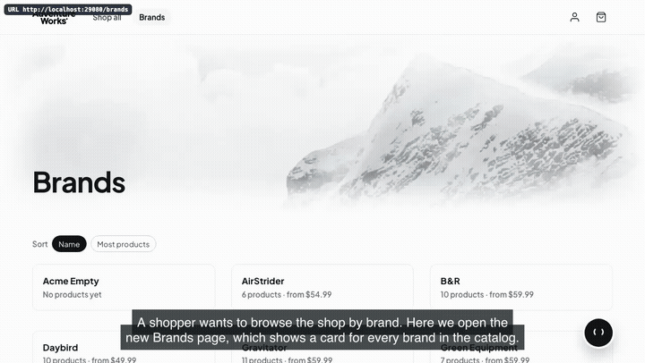](https://github.com/armandodollia-slalom/eShop-factory-test/blob/pr-videos/branch-feat-brands-shop-by-brand/brand-1-tc-brand-1-06-brands-page-has-heading-brands-and-one-card-per-brand-in-alphabetical-order.webm)

[Full video (WebM)](https://github.com/armandodollia-slalom/eShop-factory-test/blob/pr-videos/branch-feat-brands-shop-by-brand/brand-1-tc-brand-1-06-brands-page-has-heading-brands-and-one-card-per-brand-in-alphabetical-order.webm) · `teststack/brand-1.spec.ts` · 43.3 s · narrated (af_heart, speed 1) · [subtitles (VTT)](https://github.com/armandodollia-slalom/eShop-factory-test/blob/pr-videos/branch-feat-brands-shop-by-brand/brand-1-tc-brand-1-06-brands-page-has-heading-brands-and-one-card-per-brand-in-alphabetical-order.vtt)

### ✅ demo catalog (scenario brand-2) › TC-BRAND-2-09 catalog filtered to two brands shows the usual title and no "All brands" link

[Full video (WebM)](https://github.com/armandodollia-slalom/eShop-factory-test/blob/pr-videos/branch-feat-brands-shop-by-brand/brand-2-tc-brand-2-09-catalog-filtered-to-two-brands-shows-the-usual-title-and-no-all-brands-link.webm) · `teststack/brand-2.spec.ts` · 43 s · narrated (af_heart, speed 1) · [subtitles (VTT)](https://github.com/armandodollia-slalom/eShop-factory-test/blob/pr-videos/branch-feat-brands-shop-by-brand/brand-2-tc-brand-2-09-catalog-filtered-to-two-brands-shows-the-usual-title-and-no-all-brands-link.vtt)

### ✅ TC-BRAND-3-07 Brands page shows a Sort control with Name selected and cards in alphabetical order

[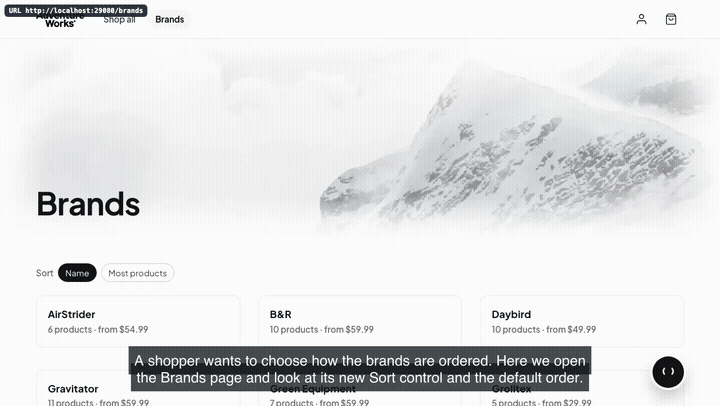](https://github.com/armandodollia-slalom/eShop-factory-test/blob/pr-videos/branch-feat-brands-shop-by-brand/brand-3-tc-brand-3-07-brands-page-shows-a-sort-control-with-name-selected-and-cards-in-alphabetical-.webm)

[Full video (WebM)](https://github.com/armandodollia-slalom/eShop-factory-test/blob/pr-videos/branch-feat-brands-shop-by-brand/brand-3-tc-brand-3-07-brands-page-shows-a-sort-control-with-name-selected-and-cards-in-alphabetical-.webm) · `teststack/brand-3.spec.ts` · 38.3 s · narrated (af_heart, speed 1) · [subtitles (VTT)](https://github.com/armandodollia-slalom/eShop-factory-test/blob/pr-videos/branch-feat-brands-shop-by-brand/brand-3-tc-brand-3-07-brands-page-shows-a-sort-control-with-name-selected-and-cards-in-alphabetical-.vtt)

### ✅ TC-EPIC-359-01 header Brands link, Daybird card to its filtered catalog, then "All brands" back to /brands

[Full video (WebM)](https://github.com/armandodollia-slalom/eShop-factory-test/blob/pr-videos/branch-feat-brands-shop-by-brand/epic-359-tc-epic-359-01-header-brands-link-daybird-card-to-its-filtered-catalog-then-all-brands-back.webm) · `teststack/epic-359.spec.ts` · 112.7 s · narrated (af_heart, speed 1) · [subtitles (VTT)](https://github.com/armandodollia-slalom/eShop-factory-test/blob/pr-videos/branch-feat-brands-shop-by-brand/epic-359-tc-epic-359-01-header-brands-link-daybird-card-to-its-filtered-catalog-then-all-brands-back.vtt)

Evidence: 21 more test-case video(s), subtitled with the automatic lines

#### ✅ TC-BRAND-1-04 header "Brands" link next to "Shop all" opens /brands

[Full video (WebM)](https://github.com/armandodollia-slalom/eShop-factory-test/blob/pr-videos/branch-feat-brands-shop-by-brand/brand-1-tc-brand-1-04-header-brands-link-next-to-shop-all-opens-brands.webm) · `teststack/brand-1.spec.ts` · 39.6 s · silent with subtitles: an evidence video: subtitled, not narrated aloud (video.script.speakEvidence) · [subtitles (VTT)](https://github.com/armandodollia-slalom/eShop-factory-test/blob/pr-videos/branch-feat-brands-shop-by-brand/brand-1-tc-brand-1-04-header-brands-link-next-to-shop-all-opens-brands.vtt)

#### ✅ TC-BRAND-1-05 "Brands" link on an item page opens /brands

[Full video (WebM)](https://github.com/armandodollia-slalom/eShop-factory-test/blob/pr-videos/branch-feat-brands-shop-by-brand/brand-1-tc-brand-1-05-brands-link-on-an-item-page-opens-brands.webm) · `teststack/brand-1.spec.ts` · 42.3 s · silent with subtitles: an evidence video: subtitled, not narrated aloud (video.script.speakEvidence) · [subtitles (VTT)](https://github.com/armandodollia-slalom/eShop-factory-test/blob/pr-videos/branch-feat-brands-shop-by-brand/brand-1-tc-brand-1-05-brands-link-on-an-item-page-opens-brands.vtt)

#### ✅ TC-BRAND-1-07 card of a brand with several products shows "N products" and "from $X.XX"

[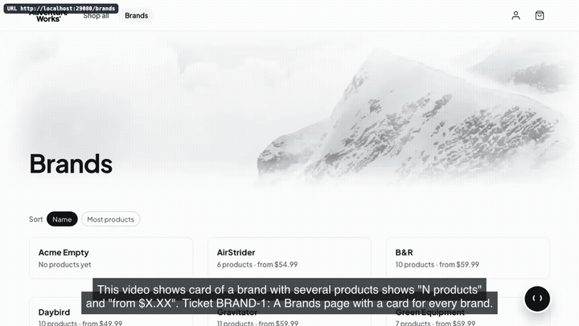](https://github.com/armandodollia-slalom/eShop-factory-test/blob/pr-videos/branch-feat-brands-shop-by-brand/brand-1-tc-brand-1-07-card-of-a-brand-with-several-products-shows-n-products-and-from-x-xx.webm)

[Full video (WebM)](https://github.com/armandodollia-slalom/eShop-factory-test/blob/pr-videos/branch-feat-brands-shop-by-brand/brand-1-tc-brand-1-07-card-of-a-brand-with-several-products-shows-n-products-and-from-x-xx.webm) · `teststack/brand-1.spec.ts` · 29.2 s · silent with subtitles: an evidence video: subtitled, not narrated aloud (video.script.speakEvidence) · [subtitles (VTT)](https://github.com/armandodollia-slalom/eShop-factory-test/blob/pr-videos/branch-feat-brands-shop-by-brand/brand-1-tc-brand-1-07-card-of-a-brand-with-several-products-shows-n-products-and-from-x-xx.vtt)

#### ✅ TC-BRAND-1-08 card of a brand with one product shows "1 product" and "from $8.50"

[Full video (WebM)](https://github.com/armandodollia-slalom/eShop-factory-test/blob/pr-videos/branch-feat-brands-shop-by-brand/brand-1-tc-brand-1-08-card-of-a-brand-with-one-product-shows-1-product-and-from-8-50.webm) · `teststack/brand-1.spec.ts` · 24.9 s · silent with subtitles: an evidence video: subtitled, not narrated aloud (video.script.speakEvidence) · [subtitles (VTT)](https://github.com/armandodollia-slalom/eShop-factory-test/blob/pr-videos/branch-feat-brands-shop-by-brand/brand-1-tc-brand-1-08-card-of-a-brand-with-one-product-shows-1-product-and-from-8-50.vtt)

#### ✅ TC-BRAND-1-09 card of a brand without products shows "No products yet" and no price

[Full video (WebM)](https://github.com/armandodollia-slalom/eShop-factory-test/blob/pr-videos/branch-feat-brands-shop-by-brand/brand-1-tc-brand-1-09-card-of-a-brand-without-products-shows-no-products-yet-and-no-price.webm) · `teststack/brand-1.spec.ts` · 29.8 s · silent with subtitles: an evidence video: subtitled, not narrated aloud (video.script.speakEvidence) · [subtitles (VTT)](https://github.com/armandodollia-slalom/eShop-factory-test/blob/pr-videos/branch-feat-brands-shop-by-brand/brand-1-tc-brand-1-09-card-of-a-brand-without-products-shows-no-products-yet-and-no-price.vtt)

#### ✅ demo catalog (scenario brand-2) › TC-BRAND-2-01 selecting the Daybird card opens the catalog filtered to Daybird

[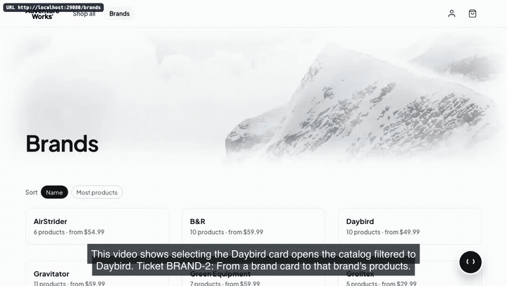](https://github.com/armandodollia-slalom/eShop-factory-test/blob/pr-videos/branch-feat-brands-shop-by-brand/brand-2-tc-brand-2-01-selecting-the-daybird-card-opens-the-catalog-filtered-to-daybird.webm)

[Full video (WebM)](https://github.com/armandodollia-slalom/eShop-factory-test/blob/pr-videos/branch-feat-brands-shop-by-brand/brand-2-tc-brand-2-01-selecting-the-daybird-card-opens-the-catalog-filtered-to-daybird.webm) · `teststack/brand-2.spec.ts` · 40.6 s · silent with subtitles: an evidence video: subtitled, not narrated aloud (video.script.speakEvidence) · [subtitles (VTT)](https://github.com/armandodollia-slalom/eShop-factory-test/blob/pr-videos/branch-feat-brands-shop-by-brand/brand-2-tc-brand-2-01-selecting-the-daybird-card-opens-the-catalog-filtered-to-daybird.vtt)

#### ✅ demo catalog (scenario brand-2) › TC-BRAND-2-02 the Gravitator card applies the same filter as the Brand filter tag

[Full video (WebM)](https://github.com/armandodollia-slalom/eShop-factory-test/blob/pr-videos/branch-feat-brands-shop-by-brand/brand-2-tc-brand-2-02-the-gravitator-card-applies-the-same-filter-as-the-brand-filter-tag.webm) · `teststack/brand-2.spec.ts` · 128.5 s · silent with subtitles: an evidence video: subtitled, not narrated aloud (video.script.speakEvidence) · [subtitles (VTT)](https://github.com/armandodollia-slalom/eShop-factory-test/blob/pr-videos/branch-feat-brands-shop-by-brand/brand-2-tc-brand-2-02-the-gravitator-card-applies-the-same-filter-as-the-brand-filter-tag.vtt)

#### ✅ demo catalog (scenario brand-2) › TC-BRAND-2-03 every brand card links to /?brand=<its own id>

[Full video (WebM)](https://github.com/armandodollia-slalom/eShop-factory-test/blob/pr-videos/branch-feat-brands-shop-by-brand/brand-2-tc-brand-2-03-every-brand-card-links-to-brand-its-own-id.webm) · `teststack/brand-2.spec.ts` · 44.6 s · silent with subtitles: an evidence video: subtitled, not narrated aloud (video.script.speakEvidence) · [subtitles (VTT)](https://github.com/armandodollia-slalom/eShop-factory-test/blob/pr-videos/branch-feat-brands-shop-by-brand/brand-2-tc-brand-2-03-every-brand-card-links-to-brand-its-own-id.vtt)

#### ✅ demo catalog (scenario brand-2) › TC-BRAND-2-04 catalog filtered to Daybird shows "Brand: Daybird" instead of the usual title

[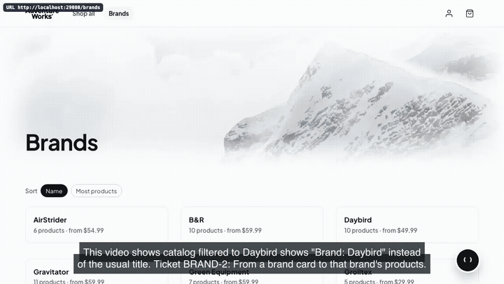](https://github.com/armandodollia-slalom/eShop-factory-test/blob/pr-videos/branch-feat-brands-shop-by-brand/brand-2-tc-brand-2-04-catalog-filtered-to-daybird-shows-brand-daybird-instead-of-the-usual-title.webm)

[Full video (WebM)](https://github.com/armandodollia-slalom/eShop-factory-test/blob/pr-videos/branch-feat-brands-shop-by-brand/brand-2-tc-brand-2-04-catalog-filtered-to-daybird-shows-brand-daybird-instead-of-the-usual-title.webm) · `teststack/brand-2.spec.ts` · 38.6 s · silent with subtitles: an evidence video: subtitled, not narrated aloud (video.script.speakEvidence) · [subtitles (VTT)](https://github.com/armandodollia-slalom/eShop-factory-test/blob/pr-videos/branch-feat-brands-shop-by-brand/brand-2-tc-brand-2-04-catalog-filtered-to-daybird-shows-brand-daybird-instead-of-the-usual-title.vtt)

#### ✅ demo catalog (scenario brand-2) › TC-BRAND-2-05 "All brands" link under the brand title opens the Brands page

[Full video (WebM)](https://github.com/armandodollia-slalom/eShop-factory-test/blob/pr-videos/branch-feat-brands-shop-by-brand/brand-2-tc-brand-2-05-all-brands-link-under-the-brand-title-opens-the-brands-page.webm) · `teststack/brand-2.spec.ts` · 47.2 s · silent with subtitles: an evidence video: subtitled, not narrated aloud (video.script.speakEvidence) · [subtitles (VTT)](https://github.com/armandodollia-slalom/eShop-factory-test/blob/pr-videos/branch-feat-brands-shop-by-brand/brand-2-tc-brand-2-05-all-brands-link-under-the-brand-title-opens-the-brands-page.vtt)

#### ✅ demo catalog (scenario brand-2) › TC-BRAND-2-06 choosing Gravitator in the Brand filter names it in the header

[Full video (WebM)](https://github.com/armandodollia-slalom/eShop-factory-test/blob/pr-videos/branch-feat-brands-shop-by-brand/brand-2-tc-brand-2-06-choosing-gravitator-in-the-brand-filter-names-it-in-the-header.webm) · `teststack/brand-2.spec.ts` · 46.6 s · silent with subtitles: an evidence video: subtitled, not narrated aloud (video.script.speakEvidence) · [subtitles (VTT)](https://github.com/armandodollia-slalom/eShop-factory-test/blob/pr-videos/branch-feat-brands-shop-by-brand/brand-2-tc-brand-2-06-choosing-gravitator-in-the-brand-filter-names-it-in-the-header.vtt)

#### ✅ demo catalog (scenario brand-2) › TC-BRAND-2-07 one brand plus a type filter still names the brand in the header

[Full video (WebM)](https://github.com/armandodollia-slalom/eShop-factory-test/blob/pr-videos/branch-feat-brands-shop-by-brand/brand-2-tc-brand-2-07-one-brand-plus-a-type-filter-still-names-the-brand-in-the-header.webm) · `teststack/brand-2.spec.ts` · 34.8 s · silent with subtitles: an evidence video: subtitled, not narrated aloud (video.script.speakEvidence) · [subtitles (VTT)](https://github.com/armandodollia-slalom/eShop-factory-test/blob/pr-videos/branch-feat-brands-shop-by-brand/brand-2-tc-brand-2-07-one-brand-plus-a-type-filter-still-names-the-brand-in-the-header.vtt)

#### ✅ demo catalog (scenario brand-2) › TC-BRAND-2-08 catalog without a brand filter shows the usual title and no "All brands" link

[Full video (WebM)](https://github.com/armandodollia-slalom/eShop-factory-test/blob/pr-videos/branch-feat-brands-shop-by-brand/brand-2-tc-brand-2-08-catalog-without-a-brand-filter-shows-the-usual-title-and-no-all-brands-link.webm) · `teststack/brand-2.spec.ts` · 30.2 s · silent with subtitles: an evidence video: subtitled, not narrated aloud (video.script.speakEvidence) · [subtitles (VTT)](https://github.com/armandodollia-slalom/eShop-factory-test/blob/pr-videos/branch-feat-brands-shop-by-brand/brand-2-tc-brand-2-08-catalog-without-a-brand-filter-shows-the-usual-title-and-no-all-brands-link.vtt)

#### ✅ brand without products (scenario brand-1) › TC-BRAND-2-10 card of a brand without products is not a link and says "No products yet"

[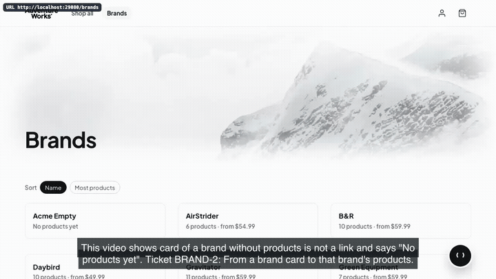](https://github.com/armandodollia-slalom/eShop-factory-test/blob/pr-videos/branch-feat-brands-shop-by-brand/brand-2-tc-brand-2-10-card-of-a-brand-without-products-is-not-a-link-and-says-no-products-yet.webm)

[Full video (WebM)](https://github.com/armandodollia-slalom/eShop-factory-test/blob/pr-videos/branch-feat-brands-shop-by-brand/brand-2-tc-brand-2-10-card-of-a-brand-without-products-is-not-a-link-and-says-no-products-yet.webm) · `teststack/brand-2.spec.ts` · 46.3 s · silent with subtitles: an evidence video: subtitled, not narrated aloud (video.script.speakEvidence) · [subtitles (VTT)](https://github.com/armandodollia-slalom/eShop-factory-test/blob/pr-videos/branch-feat-brands-shop-by-brand/brand-2-tc-brand-2-10-card-of-a-brand-without-products-is-not-a-link-and-says-no-products-yet.vtt)

#### ✅ TC-BRAND-3-08 choosing "Most products" reorders the cards by count and adds ?sort=count to the address

[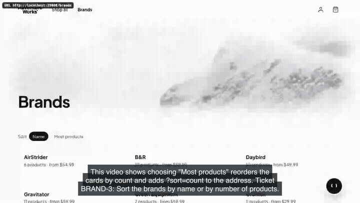](https://github.com/armandodollia-slalom/eShop-factory-test/blob/pr-videos/branch-feat-brands-shop-by-brand/brand-3-tc-brand-3-08-choosing-most-products-reorders-the-cards-by-count-and-adds-sort-count-to-the-.webm)

[Full video (WebM)](https://github.com/armandodollia-slalom/eShop-factory-test/blob/pr-videos/branch-feat-brands-shop-by-brand/brand-3-tc-brand-3-08-choosing-most-products-reorders-the-cards-by-count-and-adds-sort-count-to-the-.webm) · `teststack/brand-3.spec.ts` · 60.7 s · silent with subtitles: an evidence video: subtitled, not narrated aloud (video.script.speakEvidence) · [subtitles (VTT)](https://github.com/armandodollia-slalom/eShop-factory-test/blob/pr-videos/branch-feat-brands-shop-by-brand/brand-3-tc-brand-3-08-choosing-most-products-reorders-the-cards-by-count-and-adds-sort-count-to-the-.vtt)

#### ✅ TC-BRAND-3-09 reloading after choosing "Most products" keeps the count order

[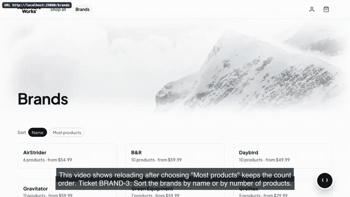](https://github.com/armandodollia-slalom/eShop-factory-test/blob/pr-videos/branch-feat-brands-shop-by-brand/brand-3-tc-brand-3-09-reloading-after-choosing-most-products-keeps-the-count-order.webm)

[Full video (WebM)](https://github.com/armandodollia-slalom/eShop-factory-test/blob/pr-videos/branch-feat-brands-shop-by-brand/brand-3-tc-brand-3-09-reloading-after-choosing-most-products-keeps-the-count-order.webm) · `teststack/brand-3.spec.ts` · 62.4 s · silent with subtitles: an evidence video: subtitled, not narrated aloud (video.script.speakEvidence) · [subtitles (VTT)](https://github.com/armandodollia-slalom/eShop-factory-test/blob/pr-videos/branch-feat-brands-shop-by-brand/brand-3-tc-brand-3-09-reloading-after-choosing-most-products-keeps-the-count-order.vtt)

#### ✅ TC-BRAND-3-10 opening /brands?sort=count directly shows "Most products" selected and the count order

[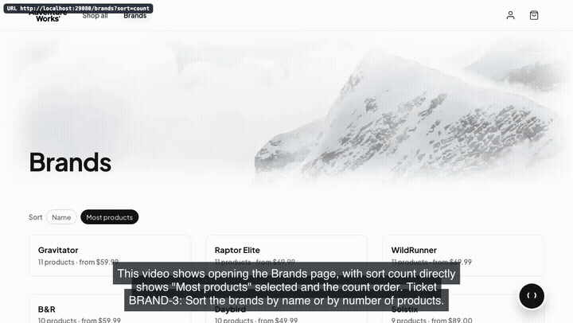](https://github.com/armandodollia-slalom/eShop-factory-test/blob/pr-videos/branch-feat-brands-shop-by-brand/brand-3-tc-brand-3-10-opening-brands-sort-count-directly-shows-most-products-selected-and-the-count-.webm)

[Full video (WebM)](https://github.com/armandodollia-slalom/eShop-factory-test/blob/pr-videos/branch-feat-brands-shop-by-brand/brand-3-tc-brand-3-10-opening-brands-sort-count-directly-shows-most-products-selected-and-the-count-.webm) · `teststack/brand-3.spec.ts` · 43.5 s · silent with subtitles: an evidence video: subtitled, not narrated aloud (video.script.speakEvidence) · [subtitles (VTT)](https://github.com/armandodollia-slalom/eShop-factory-test/blob/pr-videos/branch-feat-brands-shop-by-brand/brand-3-tc-brand-3-10-opening-brands-sort-count-directly-shows-most-products-selected-and-the-count-.vtt)

#### ✅ TC-BRAND-3-11 opening /brands with an unknown sort value shows the alphabetical order with "Name" selected

[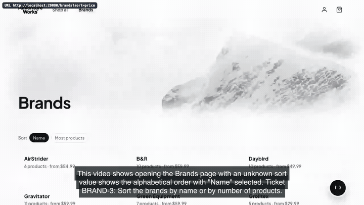](https://github.com/armandodollia-slalom/eShop-factory-test/blob/pr-videos/branch-feat-brands-shop-by-brand/brand-3-tc-brand-3-11-opening-brands-with-an-unknown-sort-value-shows-the-alphabetical-order-with-na.webm)

[Full video (WebM)](https://github.com/armandodollia-slalom/eShop-factory-test/blob/pr-videos/branch-feat-brands-shop-by-brand/brand-3-tc-brand-3-11-opening-brands-with-an-unknown-sort-value-shows-the-alphabetical-order-with-na.webm) · `teststack/brand-3.spec.ts` · 47.4 s · silent with subtitles: an evidence video: subtitled, not narrated aloud (video.script.speakEvidence) · [subtitles (VTT)](https://github.com/armandodollia-slalom/eShop-factory-test/blob/pr-videos/branch-feat-brands-shop-by-brand/brand-3-tc-brand-3-11-opening-brands-with-an-unknown-sort-value-shows-the-alphabetical-order-with-na.vtt)

#### ✅ TC-BRAND-3-12 opening /brands?sort=COUNT shows the alphabetical order with "Name" selected

[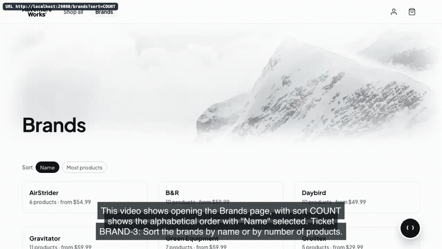](https://github.com/armandodollia-slalom/eShop-factory-test/blob/pr-videos/branch-feat-brands-shop-by-brand/brand-3-tc-brand-3-12-opening-brands-sort-count-shows-the-alphabetical-order-with-name-selected.webm)

[Full video (WebM)](https://github.com/armandodollia-slalom/eShop-factory-test/blob/pr-videos/branch-feat-brands-shop-by-brand/brand-3-tc-brand-3-12-opening-brands-sort-count-shows-the-alphabetical-order-with-name-selected.webm) · `teststack/brand-3.spec.ts` · 46.1 s · silent with subtitles: an evidence video: subtitled, not narrated aloud (video.script.speakEvidence) · [subtitles (VTT)](https://github.com/armandodollia-slalom/eShop-factory-test/blob/pr-videos/branch-feat-brands-shop-by-brand/brand-3-tc-brand-3-12-opening-brands-sort-count-shows-the-alphabetical-order-with-name-selected.vtt)

#### ✅ TC-BRAND-3-13 choosing "Name" after "Most products" restores the alphabetical order

[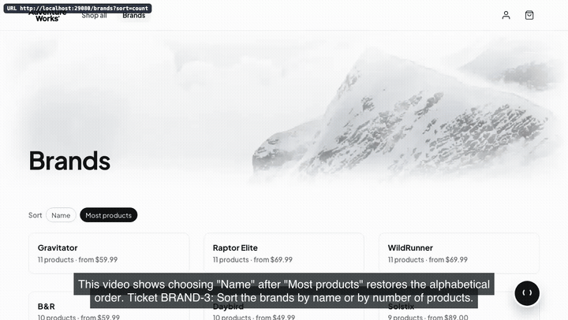](https://github.com/armandodollia-slalom/eShop-factory-test/blob/pr-videos/branch-feat-brands-shop-by-brand/brand-3-tc-brand-3-13-choosing-name-after-most-products-restores-the-alphabetical-order.webm)

[Full video (WebM)](https://github.com/armandodollia-slalom/eShop-factory-test/blob/pr-videos/branch-feat-brands-shop-by-brand/brand-3-tc-brand-3-13-choosing-name-after-most-products-restores-the-alphabetical-order.webm) · `teststack/brand-3.spec.ts` · 61.5 s · silent with subtitles: an evidence video: subtitled, not narrated aloud (video.script.speakEvidence) · [subtitles (VTT)](https://github.com/armandodollia-slalom/eShop-factory-test/blob/pr-videos/branch-feat-brands-shop-by-brand/brand-3-tc-brand-3-13-choosing-name-after-most-products-restores-the-alphabetical-order.vtt)

#### ✅ TC-EPIC-359-03 sort by "Most products", reload, then open the top brand's products

[Full video (WebM)](https://github.com/armandodollia-slalom/eShop-factory-test/blob/pr-videos/branch-feat-brands-shop-by-brand/epic-359-tc-epic-359-03-sort-by-most-products-reload-then-open-the-top-brand-s-products.webm) · `teststack/epic-359.spec.ts` · 88.8 s · silent with subtitles: an evidence video: subtitled, not narrated aloud (video.script.speakEvidence) · [subtitles (VTT)](https://github.com/armandodollia-slalom/eShop-factory-test/blob/pr-videos/branch-feat-brands-shop-by-brand/epic-359-tc-epic-359-03-sort-by-most-products-reload-then-open-the-top-brand-s-products.vtt)

Recorded, narrated and rendered on the machine that ran the pipeline (`factory pr-video local`), then checked for secrets before publishing; edits inside this section are overwritten.
