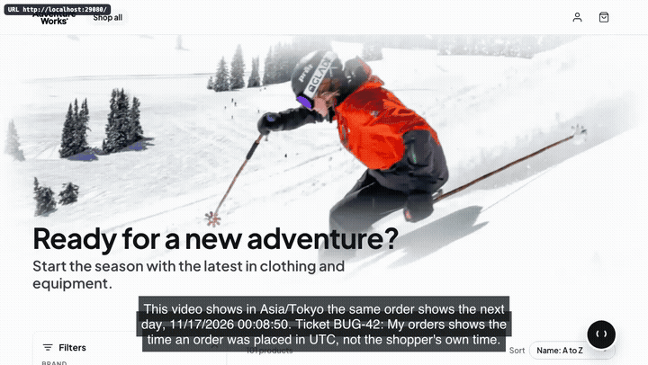
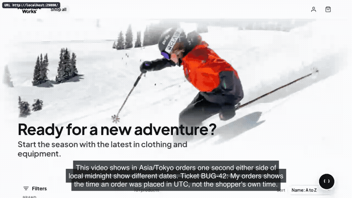
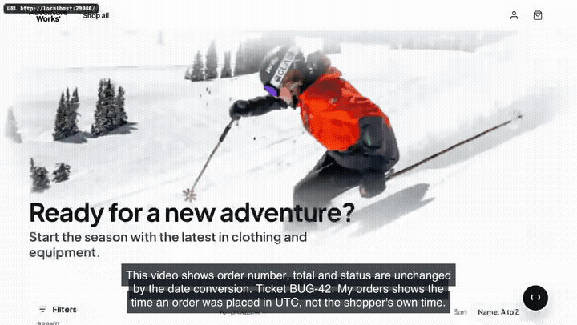
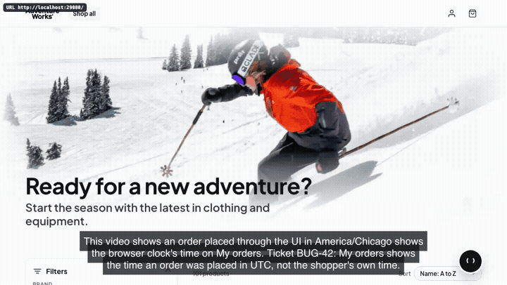

<!-- head: f1e688aeb119c6a9a47f5a26d6f820150eafe95d -->
## Demo video

Recorded on the test stack from the e2e specs this PR changes: `e2e/teststack/bug-42.spec.ts` (commit f1e688a).

### BUG-42: My orders shows the time an order was placed in UTC, not the shopper's own time

#### ✅ Before the fix

[Full video (WebM)](https://github.com/armandodollia-slalom/eShop-factory-test/blob/pr-videos/branch-feat-bug-42-fe-webapp-my-orders-shows-the-time-an-order-was-place/bug-42-before-the-fix-tc-bug-42-01-in-america-chicago-the-order-placed-at-15-08-50-utc-shows-11-16-2.webm) · `teststack/bug-42.spec.ts` · 54.4 s · narrated (af_heart, speed 1) · [subtitles (VTT)](https://github.com/armandodollia-slalom/eShop-factory-test/blob/pr-videos/branch-feat-bug-42-fe-webapp-my-orders-shows-the-time-an-order-was-place/bug-42-before-the-fix-tc-bug-42-01-in-america-chicago-the-order-placed-at-15-08-50-utc-shows-11-16-2.vtt)

#### ✅ After the fix

[Full video (WebM)](https://github.com/armandodollia-slalom/eShop-factory-test/blob/pr-videos/branch-feat-bug-42-fe-webapp-my-orders-shows-the-time-an-order-was-place/bug-42-tc-bug-42-01-in-america-chicago-the-order-placed-at-15-08-50-utc-shows-11-16-2026-09-08-50.webm) · `teststack/bug-42.spec.ts` · 52.8 s · narrated (af_heart, speed 1) · [subtitles (VTT)](https://github.com/armandodollia-slalom/eShop-factory-test/blob/pr-videos/branch-feat-bug-42-fe-webapp-my-orders-shows-the-time-an-order-was-place/bug-42-tc-bug-42-01-in-america-chicago-the-order-placed-at-15-08-50-utc-shows-11-16-2026-09-08-50.vtt)

Evidence: 5 more test-case video(s), subtitled with the automatic lines

#### ✅ seeded orders (scenario bug-42) › America/Chicago › TC-BUG-42-03 in America/Chicago every order shows its local date and time, across DST and a previous-day rollover

[Full video (WebM)](https://github.com/armandodollia-slalom/eShop-factory-test/blob/pr-videos/branch-feat-bug-42-fe-webapp-my-orders-shows-the-time-an-order-was-place/bug-42-tc-bug-42-03-in-america-chicago-every-order-shows-its-local-date-and-time-across-dst-and-a-pr.webm) · `teststack/bug-42.spec.ts` · 94.8 s · silent with subtitles: an evidence video: subtitled, not narrated aloud (video.script.speakEvidence) · [subtitles (VTT)](https://github.com/armandodollia-slalom/eShop-factory-test/blob/pr-videos/branch-feat-bug-42-fe-webapp-my-orders-shows-the-time-an-order-was-place/bug-42-tc-bug-42-03-in-america-chicago-every-order-shows-its-local-date-and-time-across-dst-and-a-pr.vtt)

#### ✅ seeded orders (scenario bug-42) › Asia/Tokyo › TC-BUG-42-02 in Asia/Tokyo the same order shows the next day, 11/17/2026 00:08:50

[Full video (WebM)](https://github.com/armandodollia-slalom/eShop-factory-test/blob/pr-videos/branch-feat-bug-42-fe-webapp-my-orders-shows-the-time-an-order-was-place/bug-42-tc-bug-42-02-in-asia-tokyo-the-same-order-shows-the-next-day-11-17-2026-00-08-50.webm) · `teststack/bug-42.spec.ts` · 57.6 s · silent with subtitles: an evidence video: subtitled, not narrated aloud (video.script.speakEvidence) · [subtitles (VTT)](https://github.com/armandodollia-slalom/eShop-factory-test/blob/pr-videos/branch-feat-bug-42-fe-webapp-my-orders-shows-the-time-an-order-was-place/bug-42-tc-bug-42-02-in-asia-tokyo-the-same-order-shows-the-next-day-11-17-2026-00-08-50.vtt)

#### ✅ seeded orders (scenario bug-42) › Asia/Tokyo › TC-BUG-42-04 in Asia/Tokyo orders one second either side of local midnight show different dates

[Full video (WebM)](https://github.com/armandodollia-slalom/eShop-factory-test/blob/pr-videos/branch-feat-bug-42-fe-webapp-my-orders-shows-the-time-an-order-was-place/bug-42-tc-bug-42-04-in-asia-tokyo-orders-one-second-either-side-of-local-midnight-show-different-dat.webm) · `teststack/bug-42.spec.ts` · 63.7 s · silent with subtitles: an evidence video: subtitled, not narrated aloud (video.script.speakEvidence) · [subtitles (VTT)](https://github.com/armandodollia-slalom/eShop-factory-test/blob/pr-videos/branch-feat-bug-42-fe-webapp-my-orders-shows-the-time-an-order-was-place/bug-42-tc-bug-42-04-in-asia-tokyo-orders-one-second-either-side-of-local-midnight-show-different-dat.vtt)

#### ✅ seeded orders (scenario bug-42) › Asia/Tokyo › TC-BUG-42-05 order number, total and status are unchanged by the date conversion

[Full video (WebM)](https://github.com/armandodollia-slalom/eShop-factory-test/blob/pr-videos/branch-feat-bug-42-fe-webapp-my-orders-shows-the-time-an-order-was-place/bug-42-tc-bug-42-05-order-number-total-and-status-are-unchanged-by-the-date-conversion.webm) · `teststack/bug-42.spec.ts` · 95.5 s · silent with subtitles: an evidence video: subtitled, not narrated aloud (video.script.speakEvidence) · [subtitles (VTT)](https://github.com/armandodollia-slalom/eShop-factory-test/blob/pr-videos/branch-feat-bug-42-fe-webapp-my-orders-shows-the-time-an-order-was-place/bug-42-tc-bug-42-05-order-number-total-and-status-are-unchanged-by-the-date-conversion.vtt)

#### ✅ bug report replay (scenario default) › TC-BUG-42-06 an order placed through the UI in America/Chicago shows the browser clock's time on My orders

[Full video (WebM)](https://github.com/armandodollia-slalom/eShop-factory-test/blob/pr-videos/branch-feat-bug-42-fe-webapp-my-orders-shows-the-time-an-order-was-place/bug-42-tc-bug-42-06-an-order-placed-through-the-ui-in-america-chicago-shows-the-browser-clock-s-time.webm) · `teststack/bug-42.spec.ts` · 102.1 s · silent with subtitles: an evidence video: subtitled, not narrated aloud (video.script.speakEvidence) · [subtitles (VTT)](https://github.com/armandodollia-slalom/eShop-factory-test/blob/pr-videos/branch-feat-bug-42-fe-webapp-my-orders-shows-the-time-an-order-was-place/bug-42-tc-bug-42-06-an-order-placed-through-the-ui-in-america-chicago-shows-the-browser-clock-s-time.vtt)

Recorded, narrated and rendered on the machine that ran the pipeline (`factory pr-video local`), then checked for secrets before publishing; edits inside this section are overwritten.
