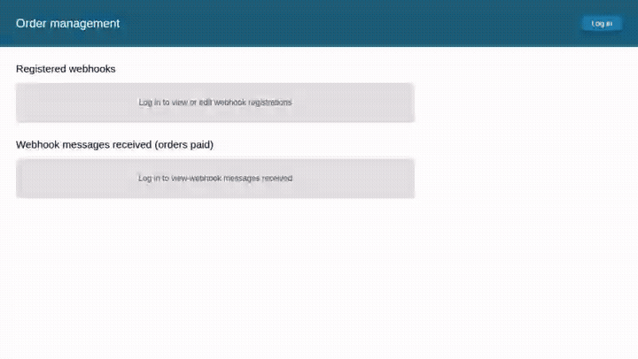
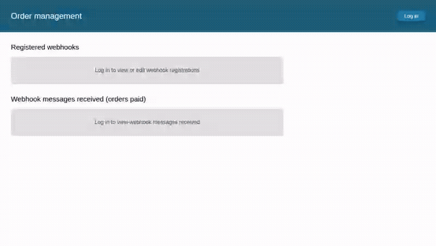

<!-- head: d4281a672efb2f71c452d813166ec1997c163005 -->
## Demo video

Recorded on the test stack from the e2e specs this PR changes: `e2e/teststack/bug-50.spec.ts` (commit d4281a6, [workflow run](https://github.com/armandodollia-slalom/eShop-factory-test/actions/runs/44239903947)).

### ✅ TC-BUG-50-01 anonymous visitor sees a log-in prompt instead of received messages and tokens

[Full video (WebM)](https://github.com/armandodollia-slalom/eShop-factory-test/blob/pr-videos/branch-feat-bug-50-fe-webhookclient-anyone-who-opens-the-webhook-client/bug-50-tc-bug-50-01-anonymous-visitor-sees-a-log-in-prompt-instead-of-received-messages-and-tokens.webm) · `teststack/bug-50.spec.ts`

### ✅ TC-BUG-50-02 signed-in user sees received messages with When, Data and Token as before

[Full video (WebM)](https://github.com/armandodollia-slalom/eShop-factory-test/blob/pr-videos/branch-feat-bug-50-fe-webhookclient-anyone-who-opens-the-webhook-client/bug-50-tc-bug-50-02-signed-in-user-sees-received-messages-with-when-data-and-token-as-before.webm) · `teststack/bug-50.spec.ts`

Updated by `.github/workflows/factory-pr-demo-video.yml` on every push; edits inside this section are overwritten.
