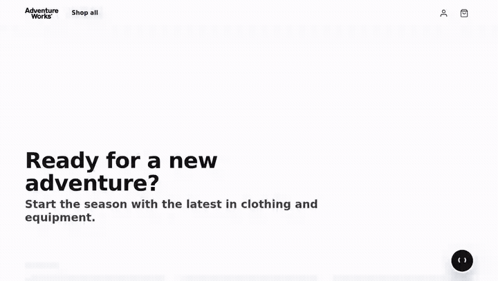

<!-- head: 73e9afc31d4d82747bd1c28e5fb5f3b46af66e68 -->
## Demo video

Recorded on the test stack from the e2e specs this PR changes: `e2e/teststack/bug-58.spec.ts` (commit 73e9afc, [workflow run](https://github.com/armandodollia-slalom/eShop-factory-test/actions/runs/44633337087)).

### ✅ TC-BUG-58-01 user name with a trailing space signs in as alice

[Full video (WebM)](https://github.com/armandodollia-slalom/eShop-factory-test/blob/pr-videos/branch-feat-bug-58-be-identity-api-signing-in-with-a-space-before-or-aft/bug-58-tc-bug-58-01-user-name-with-a-trailing-space-signs-in-as-alice--page1.webm) · `teststack/bug-58.spec.ts`

### ✅ TC-BUG-58-01 user name with a trailing space signs in as alice

[Full video (WebM)](https://github.com/armandodollia-slalom/eShop-factory-test/blob/pr-videos/branch-feat-bug-58-be-identity-api-signing-in-with-a-space-before-or-aft/bug-58-tc-bug-58-01-user-name-with-a-trailing-space-signs-in-as-alice--page2.webm) · `teststack/bug-58.spec.ts`

### ✅ TC-BUG-58-02 user name with a leading space signs in as alice

[Full video (WebM)](https://github.com/armandodollia-slalom/eShop-factory-test/blob/pr-videos/branch-feat-bug-58-be-identity-api-signing-in-with-a-space-before-or-aft/bug-58-tc-bug-58-02-user-name-with-a-leading-space-signs-in-as-alice--page1.webm) · `teststack/bug-58.spec.ts`

### ✅ TC-BUG-58-02 user name with a leading space signs in as alice

[Full video (WebM)](https://github.com/armandodollia-slalom/eShop-factory-test/blob/pr-videos/branch-feat-bug-58-be-identity-api-signing-in-with-a-space-before-or-aft/bug-58-tc-bug-58-02-user-name-with-a-leading-space-signs-in-as-alice--page2.webm) · `teststack/bug-58.spec.ts`

### ✅ TC-BUG-58-03 user name with spaces on both sides signs in as alice

[Full video (WebM)](https://github.com/armandodollia-slalom/eShop-factory-test/blob/pr-videos/branch-feat-bug-58-be-identity-api-signing-in-with-a-space-before-or-aft/bug-58-tc-bug-58-03-user-name-with-spaces-on-both-sides-signs-in-as-alice--page1.webm) · `teststack/bug-58.spec.ts`

### ✅ TC-BUG-58-03 user name with spaces on both sides signs in as alice

[Full video (WebM)](https://github.com/armandodollia-slalom/eShop-factory-test/blob/pr-videos/branch-feat-bug-58-be-identity-api-signing-in-with-a-space-before-or-aft/bug-58-tc-bug-58-03-user-name-with-spaces-on-both-sides-signs-in-as-alice--page2.webm) · `teststack/bug-58.spec.ts`

### ✅ TC-BUG-58-04 the exact user name still signs in as alice

[Full video (WebM)](https://github.com/armandodollia-slalom/eShop-factory-test/blob/pr-videos/branch-feat-bug-58-be-identity-api-signing-in-with-a-space-before-or-aft/bug-58-tc-bug-58-04-the-exact-user-name-still-signs-in-as-alice.webm) · `teststack/bug-58.spec.ts`

### ✅ TC-BUG-58-05 a spaced user name with a wrong password is still refused

[Full video (WebM)](https://github.com/armandodollia-slalom/eShop-factory-test/blob/pr-videos/branch-feat-bug-58-be-identity-api-signing-in-with-a-space-before-or-aft/bug-58-tc-bug-58-05-a-spaced-user-name-with-a-wrong-password-is-still-refused.webm) · `teststack/bug-58.spec.ts`

### ✅ TC-BUG-58-06 a spaced unknown user name with a valid password is still refused

[Full video (WebM)](https://github.com/armandodollia-slalom/eShop-factory-test/blob/pr-videos/branch-feat-bug-58-be-identity-api-signing-in-with-a-space-before-or-aft/bug-58-tc-bug-58-06-a-spaced-unknown-user-name-with-a-valid-password-is-still-refused.webm) · `teststack/bug-58.spec.ts`

Updated by `.github/workflows/factory-pr-demo-video.yml` on every push; edits inside this section are overwritten.
