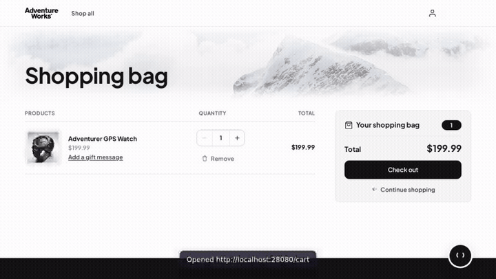

<!-- head: b81f73ca052cee3d9955ccd216f1df1bc875fa43 -->
## Demo video

Recorded on the test stack from the e2e specs this PR changes: `e2e/teststack/gift-1.spec.ts` (commit b81f73c, [workflow run](https://github.com/armandodollia-slalom/eShop-factory-test/actions/runs/44292831285)).

### ✅ TC-GIFT-1-01 a bag line without a message offers "Add a gift message" and shows no message

[Full video (WebM)](https://github.com/armandodollia-slalom/eShop-factory-test/blob/pr-videos/branch-feat-gift-1-fe-webapp-be-basket-api-add-a-gift-message-to-a-produ/gift-1-tc-gift-1-01-a-bag-line-without-a-message-offers-add-a-gift-message-and-shows-no-message.webm) · `teststack/gift-1.spec.ts`

### ✅ TC-GIFT-1-02 saving a gift message shows it in quotes under the product name with an "Edit" action

[Full video (WebM)](https://github.com/armandodollia-slalom/eShop-factory-test/blob/pr-videos/branch-feat-gift-1-fe-webapp-be-basket-api-add-a-gift-message-to-a-produ/gift-1-tc-gift-1-02-saving-a-gift-message-shows-it-in-quotes-under-the-product-name-with-an-edit-act.webm) · `teststack/gift-1.spec.ts`

### ✅ TC-GIFT-1-03 the message box stops at 60 characters and a 60-character message is saved whole

[Full video (WebM)](https://github.com/armandodollia-slalom/eShop-factory-test/blob/pr-videos/branch-feat-gift-1-fe-webapp-be-basket-api-add-a-gift-message-to-a-produ/gift-1-tc-gift-1-03-the-message-box-stops-at-60-characters-and-a-60-character-message-is-saved-whole.webm) · `teststack/gift-1.spec.ts`

### ✅ TC-GIFT-1-04 editing a gift message replaces the shown message

[Full video (WebM)](https://github.com/armandodollia-slalom/eShop-factory-test/blob/pr-videos/branch-feat-gift-1-fe-webapp-be-basket-api-add-a-gift-message-to-a-produ/gift-1-tc-gift-1-04-editing-a-gift-message-replaces-the-shown-message.webm) · `teststack/gift-1.spec.ts`

### ✅ TC-GIFT-1-05 clearing the text and saving removes the message and brings back "Add a gift message"

[Full video (WebM)](https://github.com/armandodollia-slalom/eShop-factory-test/blob/pr-videos/branch-feat-gift-1-fe-webapp-be-basket-api-add-a-gift-message-to-a-produ/gift-1-tc-gift-1-05-clearing-the-text-and-saving-removes-the-message-and-brings-back-add-a-gift-mess.webm) · `teststack/gift-1.spec.ts`

### ✅ TC-GIFT-1-06 the gift message survives a page reload

[Full video (WebM)](https://github.com/armandodollia-slalom/eShop-factory-test/blob/pr-videos/branch-feat-gift-1-fe-webapp-be-basket-api-add-a-gift-message-to-a-produ/gift-1-tc-gift-1-06-the-gift-message-survives-a-page-reload.webm) · `teststack/gift-1.spec.ts`

### ✅ TC-GIFT-1-07 the gift message survives signing out and signing in again

[Full video (WebM)](https://github.com/armandodollia-slalom/eShop-factory-test/blob/pr-videos/branch-feat-gift-1-fe-webapp-be-basket-api-add-a-gift-message-to-a-produ/gift-1-tc-gift-1-07-the-gift-message-survives-signing-out-and-signing-in-again--page1.webm) · `teststack/gift-1.spec.ts`

### ✅ TC-GIFT-1-07 the gift message survives signing out and signing in again

[Full video (WebM)](https://github.com/armandodollia-slalom/eShop-factory-test/blob/pr-videos/branch-feat-gift-1-fe-webapp-be-basket-api-add-a-gift-message-to-a-produ/gift-1-tc-gift-1-07-the-gift-message-survives-signing-out-and-signing-in-again--page2.webm) · `teststack/gift-1.spec.ts`

### ✅ TC-GIFT-1-08 the gift message survives a change of the line's quantity

[Full video (WebM)](https://github.com/armandodollia-slalom/eShop-factory-test/blob/pr-videos/branch-feat-gift-1-fe-webapp-be-basket-api-add-a-gift-message-to-a-produ/gift-1-tc-gift-1-08-the-gift-message-survives-a-change-of-the-line-s-quantity.webm) · `teststack/gift-1.spec.ts`

### ✅ TC-GIFT-1-09 removing the product and adding it again from its product page gives a line with no message

[Full video (WebM)](https://github.com/armandodollia-slalom/eShop-factory-test/blob/pr-videos/branch-feat-gift-1-fe-webapp-be-basket-api-add-a-gift-message-to-a-produ/gift-1-tc-gift-1-09-removing-the-product-and-adding-it-again-from-its-product-page-gives-a-line-with.webm) · `teststack/gift-1.spec.ts`

### ✅ TC-GIFT-1-10 placing an order from a bag with a gift message still creates the order

[Full video (WebM)](https://github.com/armandodollia-slalom/eShop-factory-test/blob/pr-videos/branch-feat-gift-1-fe-webapp-be-basket-api-add-a-gift-message-to-a-produ/gift-1-tc-gift-1-10-placing-an-order-from-a-bag-with-a-gift-message-still-creates-the-order.webm) · `teststack/gift-1.spec.ts`

### ✅ TC-GIFT-1-17 a rejected save keeps the stored message under the product name and shows an inline error

[Full video (WebM)](https://github.com/armandodollia-slalom/eShop-factory-test/blob/pr-videos/branch-feat-gift-1-fe-webapp-be-basket-api-add-a-gift-message-to-a-produ/gift-1-tc-gift-1-17-a-rejected-save-keeps-the-stored-message-under-the-product-name-and-shows-an-inl.webm) · `teststack/gift-1.spec.ts`

### ✅ TC-GIFT-1-18 a gift message post without a product id shows a notice above the bag and changes nothing

[Full video (WebM)](https://github.com/armandodollia-slalom/eShop-factory-test/blob/pr-videos/branch-feat-gift-1-fe-webapp-be-basket-api-add-a-gift-message-to-a-produ/gift-1-tc-gift-1-18-a-gift-message-post-without-a-product-id-shows-a-notice-above-the-bag-and-change.webm) · `teststack/gift-1.spec.ts`

### ✅ TC-GIFT-1-19 a gift message post without a product id on an empty bag shows the notice and the bag stays empty

[Full video (WebM)](https://github.com/armandodollia-slalom/eShop-factory-test/blob/pr-videos/branch-feat-gift-1-fe-webapp-be-basket-api-add-a-gift-message-to-a-produ/gift-1-tc-gift-1-19-a-gift-message-post-without-a-product-id-on-an-empty-bag-shows-the-notice-and-th--page1.webm) · `teststack/gift-1.spec.ts`

### ✅ TC-GIFT-1-19 a gift message post without a product id on an empty bag shows the notice and the bag stays empty

[Full video (WebM)](https://github.com/armandodollia-slalom/eShop-factory-test/blob/pr-videos/branch-feat-gift-1-fe-webapp-be-basket-api-add-a-gift-message-to-a-produ/gift-1-tc-gift-1-19-a-gift-message-post-without-a-product-id-on-an-empty-bag-shows-the-notice-and-th--page2.webm) · `teststack/gift-1.spec.ts`

Updated by `.github/workflows/factory-pr-demo-video.yml` on every push; edits inside this section are overwritten.
