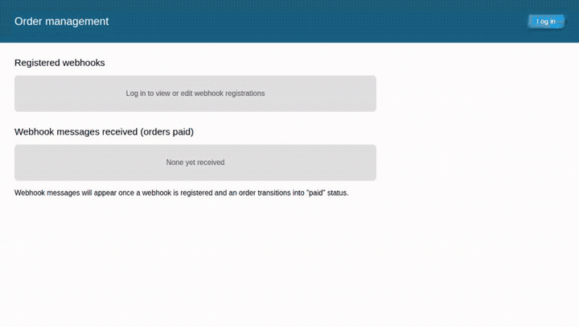
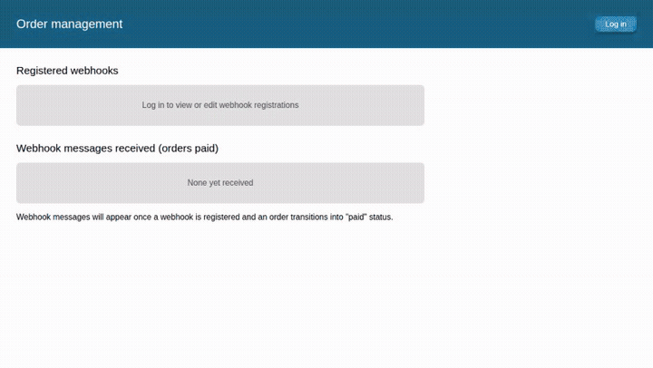
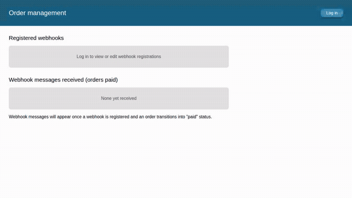
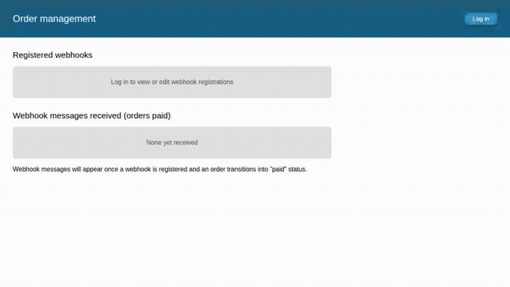
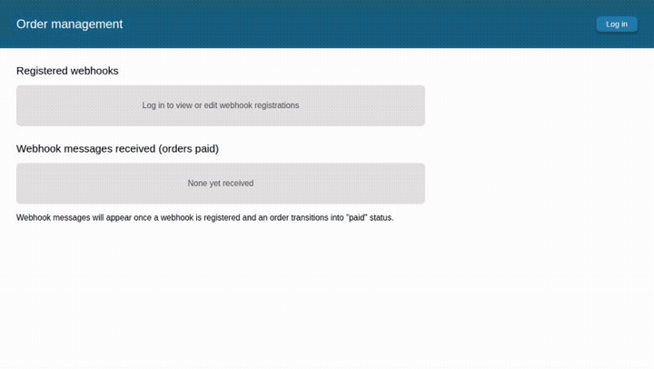
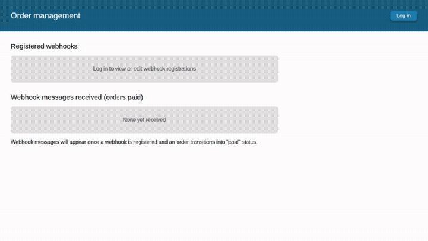

<!-- head: 028156176d87b1247be007673f913f0cc0d0a0ec -->
## Demo video

Recorded on the test stack from the e2e specs this PR changes: `e2e/teststack/bug-52.spec.ts`, `e2e/teststack/hint-1.spec.ts` (commit 0281561, [workflow run](https://github.com/armandodollia-slalom/eShop-factory-test/actions/runs/44414285678)).

### ✅ TC-BUG-52-01 Register with an empty Token box shows "A token is needed to register a webhook." next to the form

[Full video (WebM)](https://github.com/armandodollia-slalom/eShop-factory-test/blob/pr-videos/branch-feat-hint-1-fe-webhookclient-be-webhooks-api-show-only-the-end-of/bug-52-tc-bug-52-01-register-with-an-empty-token-box-shows-a-token-is-needed-to-register-a-webhook-n.webm) · `teststack/bug-52.spec.ts`

### ✅ TC-BUG-52-02 Register with an empty Token box registers no webhook

[Full video (WebM)](https://github.com/armandodollia-slalom/eShop-factory-test/blob/pr-videos/branch-feat-hint-1-fe-webhookclient-be-webhooks-api-show-only-the-end-of/bug-52-tc-bug-52-02-register-with-an-empty-token-box-registers-no-webhook.webm) · `teststack/bug-52.spec.ts`

### ✅ TC-BUG-52-03 Register with a token registers the webhook and returns to the home page as before

[Full video (WebM)](https://github.com/armandodollia-slalom/eShop-factory-test/blob/pr-videos/branch-feat-hint-1-fe-webhookclient-be-webhooks-api-show-only-the-end-of/bug-52-tc-bug-52-03-register-with-a-token-registers-the-webhook-and-returns-to-the-home-page-as-befo.webm) · `teststack/bug-52.spec.ts`

### ✅ TC-BUG-52-04 After the empty-token message, entering a token and registering succeeds

[Full video (WebM)](https://github.com/armandodollia-slalom/eShop-factory-test/blob/pr-videos/branch-feat-hint-1-fe-webhookclient-be-webhooks-api-show-only-the-end-of/bug-52-tc-bug-52-04-after-the-empty-token-message-entering-a-token-and-registering-succeeds.webm) · `teststack/bug-52.spec.ts`

### ✅ TC-HINT-1-12 after registering on /add-webhook the home page Token column shows "…" and the last 4 characters

[Full video (WebM)](https://github.com/armandodollia-slalom/eShop-factory-test/blob/pr-videos/branch-feat-hint-1-fe-webhookclient-be-webhooks-api-show-only-the-end-of/hint-1-tc-hint-1-12-after-registering-on-add-webhook-the-home-page-token-column-shows-and-the-last-4.webm) · `teststack/hint-1.spec.ts`

### ✅ TC-HINT-1-13 the home page Token column shows "None" for a webhook without a token and hints for the others

[Full video (WebM)](https://github.com/armandodollia-slalom/eShop-factory-test/blob/pr-videos/branch-feat-hint-1-fe-webhookclient-be-webhooks-api-show-only-the-end-of/hint-1-tc-hint-1-13-the-home-page-token-column-shows-none-for-a-webhook-without-a-token-and-hints-fo.webm) · `teststack/hint-1.spec.ts`

Updated by `.github/workflows/factory-pr-demo-video.yml` on every push; edits inside this section are overwritten.
