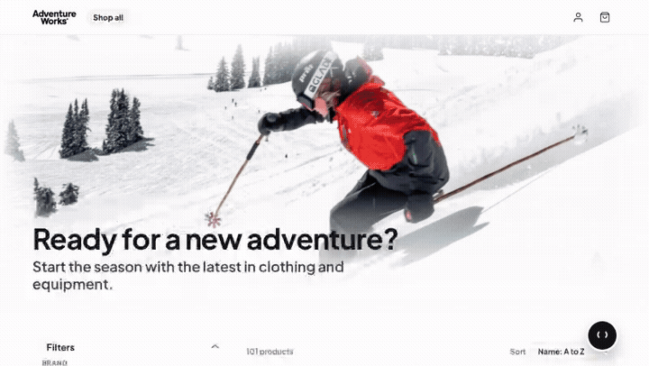

<!-- head: 0555dd605774445ab1680279eafe25df43398231 -->
## Demo video

Recorded on the test stack from the e2e specs this PR changes: `e2e/teststack/instk-1.spec.ts` (commit 0555dd6, [workflow run](https://github.com/armandodollia-slalom/eShop-factory-test/actions/runs/44609219649)).

### ✅ WebApp catalog › TC-INSTK-1-09 catalog shows an "In stock only" option, off by default

[Full video (WebM)](https://github.com/armandodollia-slalom/eShop-factory-test/blob/pr-videos/branch-feat-instk-1-fe-webapp-be-catalog-api-show-only-products-in-stock/instk-1-tc-instk-1-09-catalog-shows-an-in-stock-only-option-off-by-default.webm) · `teststack/instk-1.spec.ts`

### ✅ WebApp catalog › TC-INSTK-1-10 turning "In stock only" on lists only in-stock products and recounts products and pages

[Full video (WebM)](https://github.com/armandodollia-slalom/eShop-factory-test/blob/pr-videos/branch-feat-instk-1-fe-webapp-be-catalog-api-show-only-products-in-stock/instk-1-tc-instk-1-10-turning-in-stock-only-on-lists-only-in-stock-products-and-recounts-products-an.webm) · `teststack/instk-1.spec.ts`

### ✅ WebApp catalog › TC-INSTK-1-11 a reload or a shared link with inStock=true shows the same filtered list

[Full video (WebM)](https://github.com/armandodollia-slalom/eShop-factory-test/blob/pr-videos/branch-feat-instk-1-fe-webapp-be-catalog-api-show-only-products-in-stock/instk-1-tc-instk-1-11-a-reload-or-a-shared-link-with-instock-true-shows-the-same-filtered-list.webm) · `teststack/instk-1.spec.ts`

### ✅ WebApp catalog › TC-INSTK-1-12 "In stock only" with a brand and a type applies all three

[Full video (WebM)](https://github.com/armandodollia-slalom/eShop-factory-test/blob/pr-videos/branch-feat-instk-1-fe-webapp-be-catalog-api-show-only-products-in-stock/instk-1-tc-instk-1-12-in-stock-only-with-a-brand-and-a-type-applies-all-three.webm) · `teststack/instk-1.spec.ts`

### ✅ WebApp catalog › TC-INSTK-1-13 paging keeps the type and "In stock only" filters

[Full video (WebM)](https://github.com/armandodollia-slalom/eShop-factory-test/blob/pr-videos/branch-feat-instk-1-fe-webapp-be-catalog-api-show-only-products-in-stock/instk-1-tc-instk-1-13-paging-keeps-the-type-and-in-stock-only-filters.webm) · `teststack/instk-1.spec.ts`

### ✅ WebApp catalog › TC-INSTK-1-14 sort order applies together with "In stock only" and survives paging

[Full video (WebM)](https://github.com/armandodollia-slalom/eShop-factory-test/blob/pr-videos/branch-feat-instk-1-fe-webapp-be-catalog-api-show-only-products-in-stock/instk-1-tc-instk-1-14-sort-order-applies-together-with-in-stock-only-and-survives-paging.webm) · `teststack/instk-1.spec.ts`

### ✅ WebApp catalog › TC-INSTK-1-15 "Clear all filters" in the filter panel turns "In stock only" off

[Full video (WebM)](https://github.com/armandodollia-slalom/eShop-factory-test/blob/pr-videos/branch-feat-instk-1-fe-webapp-be-catalog-api-show-only-products-in-stock/instk-1-tc-instk-1-15-clear-all-filters-in-the-filter-panel-turns-in-stock-only-off.webm) · `teststack/instk-1.spec.ts`

### ✅ WebApp catalog › TC-INSTK-1-16 "Clear all filters" in the empty state turns "In stock only" off

[Full video (WebM)](https://github.com/armandodollia-slalom/eShop-factory-test/blob/pr-videos/branch-feat-instk-1-fe-webapp-be-catalog-api-show-only-products-in-stock/instk-1-tc-instk-1-16-clear-all-filters-in-the-empty-state-turns-in-stock-only-off.webm) · `teststack/instk-1.spec.ts`

### ✅ WebApp catalog › TC-INSTK-1-17 turning "In stock only" off again lists every product

[Full video (WebM)](https://github.com/armandodollia-slalom/eShop-factory-test/blob/pr-videos/branch-feat-instk-1-fe-webapp-be-catalog-api-show-only-products-in-stock/instk-1-tc-instk-1-17-turning-in-stock-only-off-again-lists-every-product.webm) · `teststack/instk-1.spec.ts`

### ✅ WebApp catalog, WildRunner paging › TC-INSTK-1-18 paging keeps the brand and "In stock only" filters

[Full video (WebM)](https://github.com/armandodollia-slalom/eShop-factory-test/blob/pr-videos/branch-feat-instk-1-fe-webapp-be-catalog-api-show-only-products-in-stock/instk-1-tc-instk-1-18-paging-keeps-the-brand-and-in-stock-only-filters.webm) · `teststack/instk-1.spec.ts`

Updated by `.github/workflows/factory-pr-demo-video.yml` on every push; edits inside this section are overwritten.
