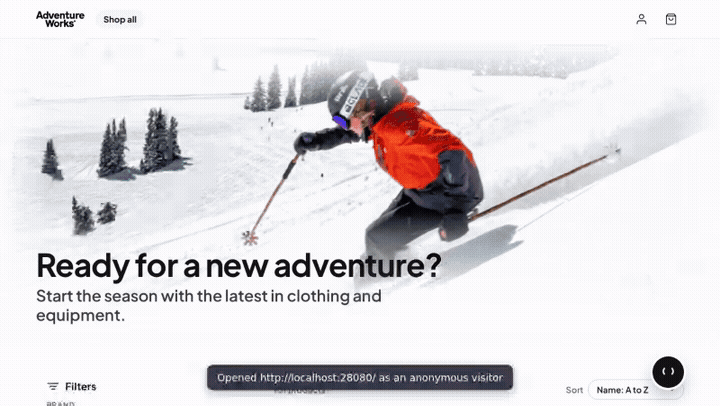
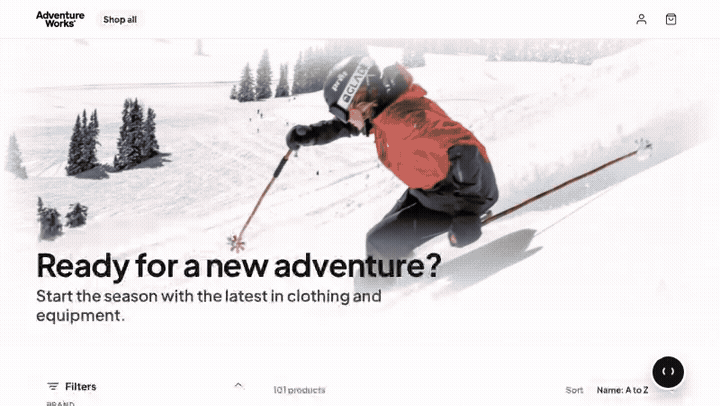
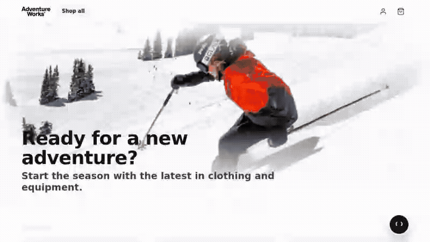
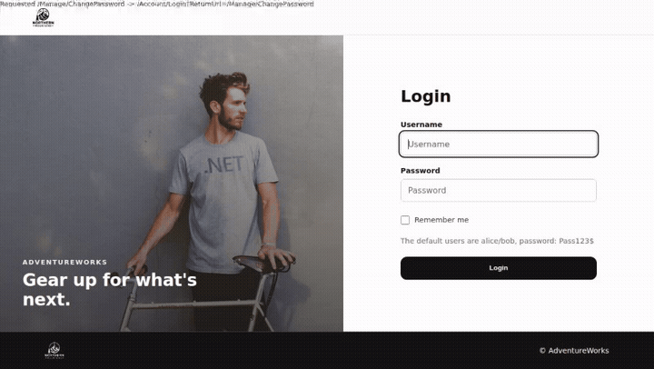
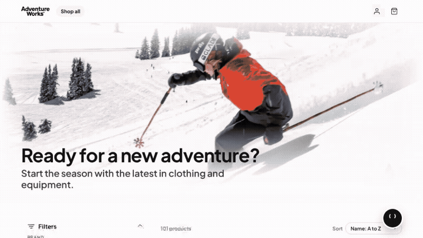

<!-- head: bcd08cb9b6c89a49c48284e52a2e53354c95d0cb -->
## Demo video

Recorded on the test stack from the e2e specs this PR changes: `e2e/teststack/pwd-1.spec.ts` (commit bcd08cb, [workflow run](https://github.com/armandodollia-slalom/eShop-factory-test/actions/runs/44461009041)).

### ✅ TC-PWD-1-01 signed-in shopper's user menu has "Change password" just before "Log out", opening the Identity change page

[Full video (WebM)](https://github.com/armandodollia-slalom/eShop-factory-test/blob/pr-videos/branch-feat-pwd-1-fe-webapp-be-identity-api-let-shoppers-replace-their-o/pwd-1-tc-pwd-1-01-signed-in-shopper-s-user-menu-has-change-password-just-before-log-out-opening-the-.webm) · `teststack/pwd-1.spec.ts`

### ✅ TC-PWD-1-02 visitor who is not signed in sees no "Change password" entry

[Full video (WebM)](https://github.com/armandodollia-slalom/eShop-factory-test/blob/pr-videos/branch-feat-pwd-1-fe-webapp-be-identity-api-let-shoppers-replace-their-o/pwd-1-tc-pwd-1-02-visitor-who-is-not-signed-in-sees-no-change-password-entry.webm) · `teststack/pwd-1.spec.ts`

### ✅ TC-PWD-1-03 valid change shows the confirmation and a "Back to the shop" link to the shop home

[Full video (WebM)](https://github.com/armandodollia-slalom/eShop-factory-test/blob/pr-videos/branch-feat-pwd-1-fe-webapp-be-identity-api-let-shoppers-replace-their-o/pwd-1-tc-pwd-1-03-valid-change-shows-the-confirmation-and-a-back-to-the-shop-link-to-the-shop-home.webm) · `teststack/pwd-1.spec.ts`

### ✅ TC-PWD-1-05 after a change, the old password is refused at sign-in

[Full video (WebM)](https://github.com/armandodollia-slalom/eShop-factory-test/blob/pr-videos/branch-feat-pwd-1-fe-webapp-be-identity-api-let-shoppers-replace-their-o/pwd-1-tc-pwd-1-05-after-a-change-the-old-password-is-refused-at-sign-in--page1.webm) · `teststack/pwd-1.spec.ts`

### ✅ TC-PWD-1-05 after a change, the old password is refused at sign-in

[Full video (WebM)](https://github.com/armandodollia-slalom/eShop-factory-test/blob/pr-videos/branch-feat-pwd-1-fe-webapp-be-identity-api-let-shoppers-replace-their-o/pwd-1-tc-pwd-1-05-after-a-change-the-old-password-is-refused-at-sign-in--page2.webm) · `teststack/pwd-1.spec.ts`

### ✅ TC-PWD-1-06 wrong current password shows "The current password is incorrect." and changes nothing

[Full video (WebM)](https://github.com/armandodollia-slalom/eShop-factory-test/blob/pr-videos/branch-feat-pwd-1-fe-webapp-be-identity-api-let-shoppers-replace-their-o/pwd-1-tc-pwd-1-06-wrong-current-password-shows-the-current-password-is-incorrect-and-changes-nothing--page1.webm) · `teststack/pwd-1.spec.ts`

### ✅ TC-PWD-1-06 wrong current password shows "The current password is incorrect." and changes nothing

[Full video (WebM)](https://github.com/armandodollia-slalom/eShop-factory-test/blob/pr-videos/branch-feat-pwd-1-fe-webapp-be-identity-api-let-shoppers-replace-their-o/pwd-1-tc-pwd-1-06-wrong-current-password-shows-the-current-password-is-incorrect-and-changes-nothing--page2.webm) · `teststack/pwd-1.spec.ts`

### ✅ TC-PWD-1-06 wrong current password shows "The current password is incorrect." and changes nothing

[Full video (WebM)](https://github.com/armandodollia-slalom/eShop-factory-test/blob/pr-videos/branch-feat-pwd-1-fe-webapp-be-identity-api-let-shoppers-replace-their-o/pwd-1-tc-pwd-1-06-wrong-current-password-shows-the-current-password-is-incorrect-and-changes-nothing--page3.webm) · `teststack/pwd-1.spec.ts`

### ✅ TC-PWD-1-07 new and confirmation entries that differ are reported and change nothing

[Full video (WebM)](https://github.com/armandodollia-slalom/eShop-factory-test/blob/pr-videos/branch-feat-pwd-1-fe-webapp-be-identity-api-let-shoppers-replace-their-o/pwd-1-tc-pwd-1-07-new-and-confirmation-entries-that-differ-are-reported-and-change-nothing--page1.webm) · `teststack/pwd-1.spec.ts`

### ✅ TC-PWD-1-07 new and confirmation entries that differ are reported and change nothing

[Full video (WebM)](https://github.com/armandodollia-slalom/eShop-factory-test/blob/pr-videos/branch-feat-pwd-1-fe-webapp-be-identity-api-let-shoppers-replace-their-o/pwd-1-tc-pwd-1-07-new-and-confirmation-entries-that-differ-are-reported-and-change-nothing--page2.webm) · `teststack/pwd-1.spec.ts`

### ✅ TC-PWD-1-08 new password breaking Identity's character rules shows Identity's own messages and changes nothing

[Full video (WebM)](https://github.com/armandodollia-slalom/eShop-factory-test/blob/pr-videos/branch-feat-pwd-1-fe-webapp-be-identity-api-let-shoppers-replace-their-o/pwd-1-tc-pwd-1-08-new-password-breaking-identity-s-character-rules-shows-identity-s-own-messages-and--page1.webm) · `teststack/pwd-1.spec.ts`

### ✅ TC-PWD-1-08 new password breaking Identity's character rules shows Identity's own messages and changes nothing

[Full video (WebM)](https://github.com/armandodollia-slalom/eShop-factory-test/blob/pr-videos/branch-feat-pwd-1-fe-webapp-be-identity-api-let-shoppers-replace-their-o/pwd-1-tc-pwd-1-08-new-password-breaking-identity-s-character-rules-shows-identity-s-own-messages-and--page2.webm) · `teststack/pwd-1.spec.ts`

### ✅ TC-PWD-1-09 new password of 5 characters (one below minimum) is refused

[Full video (WebM)](https://github.com/armandodollia-slalom/eShop-factory-test/blob/pr-videos/branch-feat-pwd-1-fe-webapp-be-identity-api-let-shoppers-replace-their-o/pwd-1-tc-pwd-1-09-new-password-of-5-characters-one-below-minimum-is-refused--page1.webm) · `teststack/pwd-1.spec.ts`

### ✅ TC-PWD-1-09 new password of 5 characters (one below minimum) is refused

[Full video (WebM)](https://github.com/armandodollia-slalom/eShop-factory-test/blob/pr-videos/branch-feat-pwd-1-fe-webapp-be-identity-api-let-shoppers-replace-their-o/pwd-1-tc-pwd-1-09-new-password-of-5-characters-one-below-minimum-is-refused--page2.webm) · `teststack/pwd-1.spec.ts`

### ✅ TC-PWD-1-10 new password of exactly 6 characters (minimum) is accepted

[Full video (WebM)](https://github.com/armandodollia-slalom/eShop-factory-test/blob/pr-videos/branch-feat-pwd-1-fe-webapp-be-identity-api-let-shoppers-replace-their-o/pwd-1-tc-pwd-1-10-new-password-of-exactly-6-characters-minimum-is-accepted--page1.webm) · `teststack/pwd-1.spec.ts`

### ✅ TC-PWD-1-10 new password of exactly 6 characters (minimum) is accepted

[Full video (WebM)](https://github.com/armandodollia-slalom/eShop-factory-test/blob/pr-videos/branch-feat-pwd-1-fe-webapp-be-identity-api-let-shoppers-replace-their-o/pwd-1-tc-pwd-1-10-new-password-of-exactly-6-characters-minimum-is-accepted--page2.webm) · `teststack/pwd-1.spec.ts`

### ✅ TC-PWD-1-11 new password of 101 characters (one above maximum) is refused

[Full video (WebM)](https://github.com/armandodollia-slalom/eShop-factory-test/blob/pr-videos/branch-feat-pwd-1-fe-webapp-be-identity-api-let-shoppers-replace-their-o/pwd-1-tc-pwd-1-11-new-password-of-101-characters-one-above-maximum-is-refused--page1.webm) · `teststack/pwd-1.spec.ts`

### ✅ TC-PWD-1-11 new password of 101 characters (one above maximum) is refused

[Full video (WebM)](https://github.com/armandodollia-slalom/eShop-factory-test/blob/pr-videos/branch-feat-pwd-1-fe-webapp-be-identity-api-let-shoppers-replace-their-o/pwd-1-tc-pwd-1-11-new-password-of-101-characters-one-above-maximum-is-refused--page2.webm) · `teststack/pwd-1.spec.ts`

### ✅ TC-PWD-1-12 opening the change page without an Identity session asks to sign in and returns to the change page

[Full video (WebM)](https://github.com/armandodollia-slalom/eShop-factory-test/blob/pr-videos/branch-feat-pwd-1-fe-webapp-be-identity-api-let-shoppers-replace-their-o/pwd-1-tc-pwd-1-12-opening-the-change-page-without-an-identity-session-asks-to-sign-in-and-returns-to--page1.webm) · `teststack/pwd-1.spec.ts`

### ✅ TC-PWD-1-12 opening the change page without an Identity session asks to sign in and returns to the change page

[Full video (WebM)](https://github.com/armandodollia-slalom/eShop-factory-test/blob/pr-videos/branch-feat-pwd-1-fe-webapp-be-identity-api-let-shoppers-replace-their-o/pwd-1-tc-pwd-1-12-opening-the-change-page-without-an-identity-session-asks-to-sign-in-and-returns-to--page2.webm) · `teststack/pwd-1.spec.ts`

### ✅ TC-PWD-1-13 submitting the change form empty shows the required-field messages and changes nothing

[Full video (WebM)](https://github.com/armandodollia-slalom/eShop-factory-test/blob/pr-videos/branch-feat-pwd-1-fe-webapp-be-identity-api-let-shoppers-replace-their-o/pwd-1-tc-pwd-1-13-submitting-the-change-form-empty-shows-the-required-field-messages-and-changes-not--page1.webm) · `teststack/pwd-1.spec.ts`

### ✅ TC-PWD-1-13 submitting the change form empty shows the required-field messages and changes nothing

[Full video (WebM)](https://github.com/armandodollia-slalom/eShop-factory-test/blob/pr-videos/branch-feat-pwd-1-fe-webapp-be-identity-api-let-shoppers-replace-their-o/pwd-1-tc-pwd-1-13-submitting-the-change-form-empty-shows-the-required-field-messages-and-changes-not--page2.webm) · `teststack/pwd-1.spec.ts`

### ✅ TC-PWD-1-14 new password without a lowercase letter shows Identity's lowercase message and changes nothing

[Full video (WebM)](https://github.com/armandodollia-slalom/eShop-factory-test/blob/pr-videos/branch-feat-pwd-1-fe-webapp-be-identity-api-let-shoppers-replace-their-o/pwd-1-tc-pwd-1-14-new-password-without-a-lowercase-letter-shows-identity-s-lowercase-message-and-cha--page1.webm) · `teststack/pwd-1.spec.ts`

### ✅ TC-PWD-1-14 new password without a lowercase letter shows Identity's lowercase message and changes nothing

[Full video (WebM)](https://github.com/armandodollia-slalom/eShop-factory-test/blob/pr-videos/branch-feat-pwd-1-fe-webapp-be-identity-api-let-shoppers-replace-their-o/pwd-1-tc-pwd-1-14-new-password-without-a-lowercase-letter-shows-identity-s-lowercase-message-and-cha--page2.webm) · `teststack/pwd-1.spec.ts`

### ✅ TC-PWD-1-15 new password of exactly 100 characters (maximum) is accepted

[Full video (WebM)](https://github.com/armandodollia-slalom/eShop-factory-test/blob/pr-videos/branch-feat-pwd-1-fe-webapp-be-identity-api-let-shoppers-replace-their-o/pwd-1-tc-pwd-1-15-new-password-of-exactly-100-characters-maximum-is-accepted--page1.webm) · `teststack/pwd-1.spec.ts`

### ✅ TC-PWD-1-15 new password of exactly 100 characters (maximum) is accepted

[Full video (WebM)](https://github.com/armandodollia-slalom/eShop-factory-test/blob/pr-videos/branch-feat-pwd-1-fe-webapp-be-identity-api-let-shoppers-replace-their-o/pwd-1-tc-pwd-1-15-new-password-of-exactly-100-characters-maximum-is-accepted--page2.webm) · `teststack/pwd-1.spec.ts`

Updated by `.github/workflows/factory-pr-demo-video.yml` on every push; edits inside this section are overwritten.
