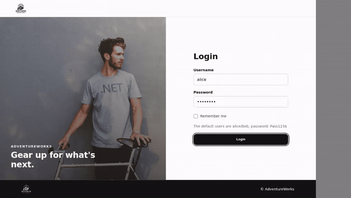
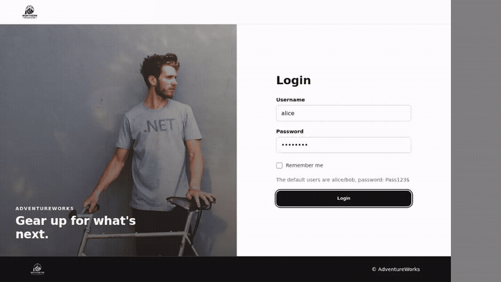
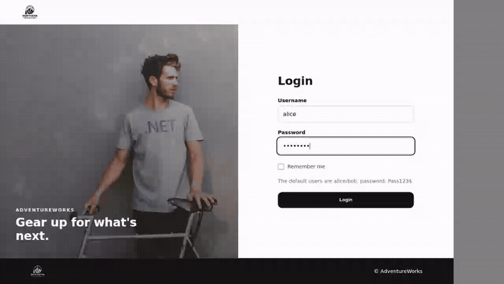

<!-- head: a40369eebe28fc6ef8ad9348af079212f371cb08 -->
## Demo video

Recorded on the test stack from the e2e specs this PR changes: `e2e/teststack/ship-1.spec.ts` (commit a40369e, [workflow run](https://github.com/armandodollia-slalom/eShop-factory-test/actions/runs/44320115262)).

### ✅ TC-SHIP-1-01 the order list returns each order's city and country as entered at checkout

[Full video (WebM)](https://github.com/armandodollia-slalom/eShop-factory-test/blob/pr-videos/branch-feat-ship-1-fe-webapp-be-ordering-api-show-where-each-order-ships/ship-1-tc-ship-1-01-the-order-list-returns-each-order-s-city-and-country-as-entered-at-checkout--page1.webm) · `teststack/ship-1.spec.ts`

### ✅ TC-SHIP-1-01 the order list returns each order's city and country as entered at checkout

[Full video (WebM)](https://github.com/armandodollia-slalom/eShop-factory-test/blob/pr-videos/branch-feat-ship-1-fe-webapp-be-ordering-api-show-where-each-order-ships/ship-1-tc-ship-1-01-the-order-list-returns-each-order-s-city-and-country-as-entered-at-checkout--page2.webm) · `teststack/ship-1.spec.ts`

### ✅ TC-SHIP-1-02 the order list keeps every existing field with its name and value

[Full video (WebM)](https://github.com/armandodollia-slalom/eShop-factory-test/blob/pr-videos/branch-feat-ship-1-fe-webapp-be-ordering-api-show-where-each-order-ships/ship-1-tc-ship-1-02-the-order-list-keeps-every-existing-field-with-its-name-and-value--page1.webm) · `teststack/ship-1.spec.ts`

### ✅ TC-SHIP-1-02 the order list keeps every existing field with its name and value

[Full video (WebM)](https://github.com/armandodollia-slalom/eShop-factory-test/blob/pr-videos/branch-feat-ship-1-fe-webapp-be-ordering-api-show-where-each-order-ships/ship-1-tc-ship-1-02-the-order-list-keeps-every-existing-field-with-its-name-and-value--page2.webm) · `teststack/ship-1.spec.ts`

### ✅ TC-SHIP-1-03 My orders shows a "Ships to" column with the order's city and country

[Full video (WebM)](https://github.com/armandodollia-slalom/eShop-factory-test/blob/pr-videos/branch-feat-ship-1-fe-webapp-be-ordering-api-show-where-each-order-ships/ship-1-tc-ship-1-03-my-orders-shows-a-ships-to-column-with-the-order-s-city-and-country--page1.webm) · `teststack/ship-1.spec.ts`

### ✅ TC-SHIP-1-03 My orders shows a "Ships to" column with the order's city and country

[Full video (WebM)](https://github.com/armandodollia-slalom/eShop-factory-test/blob/pr-videos/branch-feat-ship-1-fe-webapp-be-ordering-api-show-where-each-order-ships/ship-1-tc-ship-1-03-my-orders-shows-a-ships-to-column-with-the-order-s-city-and-country--page2.webm) · `teststack/ship-1.spec.ts`

### ✅ TC-SHIP-1-04 two orders with different addresses each show their own city and country

[Full video (WebM)](https://github.com/armandodollia-slalom/eShop-factory-test/blob/pr-videos/branch-feat-ship-1-fe-webapp-be-ordering-api-show-where-each-order-ships/ship-1-tc-ship-1-04-two-orders-with-different-addresses-each-show-their-own-city-and-country--page1.webm) · `teststack/ship-1.spec.ts`

### ✅ TC-SHIP-1-04 two orders with different addresses each show their own city and country

[Full video (WebM)](https://github.com/armandodollia-slalom/eShop-factory-test/blob/pr-videos/branch-feat-ship-1-fe-webapp-be-ordering-api-show-where-each-order-ships/ship-1-tc-ship-1-04-two-orders-with-different-addresses-each-show-their-own-city-and-country--page2.webm) · `teststack/ship-1.spec.ts`

### ✅ TC-SHIP-1-05 a shopper with no orders sees the unchanged empty state

[Full video (WebM)](https://github.com/armandodollia-slalom/eShop-factory-test/blob/pr-videos/branch-feat-ship-1-fe-webapp-be-ordering-api-show-where-each-order-ships/ship-1-tc-ship-1-05-a-shopper-with-no-orders-sees-the-unchanged-empty-state.webm) · `teststack/ship-1.spec.ts`

### ✅ TC-SHIP-1-06 number, date, total and status columns show the same values as before

[Full video (WebM)](https://github.com/armandodollia-slalom/eShop-factory-test/blob/pr-videos/branch-feat-ship-1-fe-webapp-be-ordering-api-show-where-each-order-ships/ship-1-tc-ship-1-06-number-date-total-and-status-columns-show-the-same-values-as-before--page1.webm) · `teststack/ship-1.spec.ts`

### ✅ TC-SHIP-1-06 number, date, total and status columns show the same values as before

[Full video (WebM)](https://github.com/armandodollia-slalom/eShop-factory-test/blob/pr-videos/branch-feat-ship-1-fe-webapp-be-ordering-api-show-where-each-order-ships/ship-1-tc-ship-1-06-number-date-total-and-status-columns-show-the-same-values-as-before--page2.webm) · `teststack/ship-1.spec.ts`

### ✅ phone width › TC-SHIP-1-07 at phone width "Ships to" takes its row's full width and the page does not scroll sideways

[Full video (WebM)](https://github.com/armandodollia-slalom/eShop-factory-test/blob/pr-videos/branch-feat-ship-1-fe-webapp-be-ordering-api-show-where-each-order-ships/ship-1-tc-ship-1-07-at-phone-width-ships-to-takes-its-row-s-full-width-and-the-page-does-not-scroll---page1.webm) · `teststack/ship-1.spec.ts`

### ✅ phone width › TC-SHIP-1-07 at phone width "Ships to" takes its row's full width and the page does not scroll sideways

[Full video (WebM)](https://github.com/armandodollia-slalom/eShop-factory-test/blob/pr-videos/branch-feat-ship-1-fe-webapp-be-ordering-api-show-where-each-order-ships/ship-1-tc-ship-1-07-at-phone-width-ships-to-takes-its-row-s-full-width-and-the-page-does-not-scroll---page2.webm) · `teststack/ship-1.spec.ts`

Updated by `.github/workflows/factory-pr-demo-video.yml` on every push; edits inside this section are overwritten.
